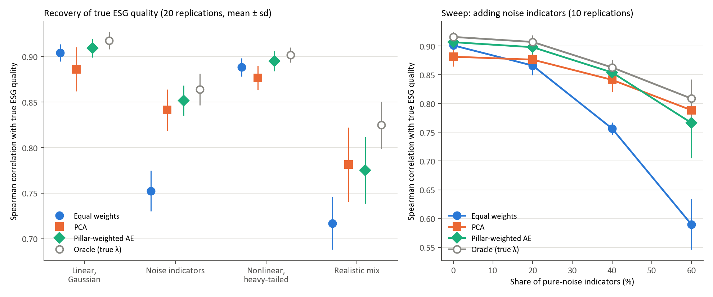
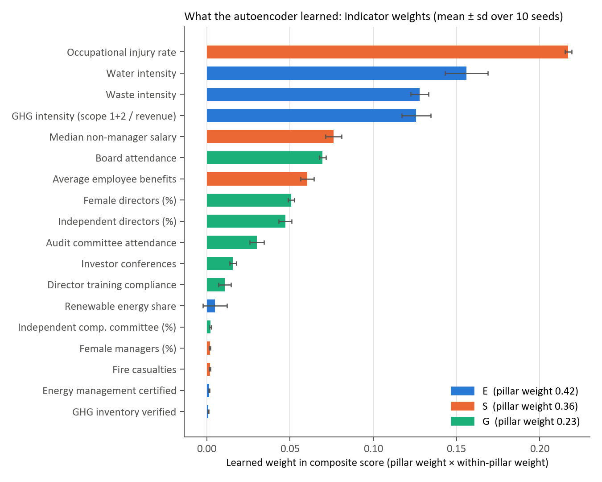
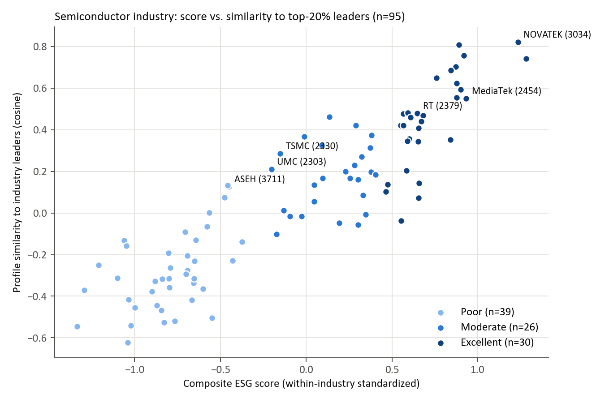

# Data-Driven ESG Scoring for Taiwan-Listed Companies

A small research project that builds composite ESG scores for **1,077 companies listed on the Taiwan Stock Exchange** from their official ESG disclosures, using a **pillar-weighted autoencoder** to learn indicator weights from data. Firms are then compared within their industry and grouped into excellent / moderate / poor tiers.

Because real data has no ground-truth "ESG quality", the method is first checked in a **simulation study** where the truth is known. That study shows when learned weights beat simple averaging and when they don't.

## Pipeline

| Step | What it does | Code |
|---|---|---|
| 1. Data | Downloads 21 ESG disclosure topics, company info and revenue from the TWSE OpenAPI; builds 18 indicators | `fetch_data.py`, `build_dataset.py` |
| 2. Reweighting | Learns indicator and pillar weights with a pillar-weighted autoencoder; compares with equal weights and PCA | `model.py` |
| 3. Peer comparison | Measures each firm's similarity to its industry's top-20% "leader profile" and finds its most similar peers | `score_real.py` |
| 4. Tiers | Uses k-means within each industry to split firms into excellent / moderate / poor | `score_real.py` |
| 5. Validation | Runs a simulation with known true quality, under 4 scenarios plus a noise sweep | `simulate.py` |

## Data

* **Source:** [TWSE OpenAPI](https://openapi.twse.com.tw/), *上市公司企業 ESG 資訊揭露彙總資料*, reporting year 2025 (ROC 114), 1,077 firms. It is public and needs no registration.
* **18 indicators:**
  * **E (6):** GHG intensity (scope 1+2 ÷ revenue), water intensity, waste intensity, renewable-energy share, GHG-inventory verification, energy-management certification.
  * **S (5):** average employee benefits, median non-manager salary, female managers %, occupational injury rate, fire casualties.
  * **G (7):** independent directors %, female directors %, board attendance, director training compliance, investor conferences, audit-committee attendance, independent compensation committee %.
* **Intensities:** these are recomputed from raw totals ÷ Jan–Sep 2025 revenue, because self-reported intensities use incompatible units across firms.
* **Preprocessing:**
  * Skewed variables are log-transformed.
  * Every indicator is oriented so that higher means better.
  * Each indicator gets a robust z-score (median / MAD, clipped to ±3) **within industry**. Industries with fewer than 20 firms are merged, giving 23 peer groups.
  * Missing values are kept as missing; they are not imputed.

## Model: pillar-weighted autoencoder

```
indicator x_j  ──softmax weights within pillar──►  pillar scores (s_E, s_S, s_G)  ──MLP decoder──►  reconstructed x̂
```

* Within each pillar, the score is a weighted average with **non-negative weights that sum to 1**. This keeps the weights directly interpretable, and a firm can never lose points by improving an indicator.
* The decoder must reconstruct all 18 indicators from only three numbers. So the weights shift toward indicators that carry the most information.
* The loss is **masked MSE** on observed cells only, so missing data needs no imputation. Weights are renormalized per firm over its observed indicators.
* **Pillar weight** is the share of reconstruction error that appears when that pillar's score is replaced by its mean.
* The composite score is the pillar scores weighted by these pillar weights. The final score averages 10 random seeds.

**Baselines:** an equal-weight average of the observed indicators, and the first principal component (PCA).

## Validation by simulation

**Setup:**
* 1,000 synthetic firms in 20 industries, with the same 18-indicator / 3-pillar layout as the real data.
* Each firm has latent pillar qualities (correlation 0.3). The true overall quality is their mean.
* Indicators are signal × loading λ ∈ [0.3, 1], plus an industry shift and noise. "Noise indicators" have λ = 0.
* The simulated data goes through the **same** within-industry standardization as the real data.
* An *Oracle* that knows the true λ gives the best achievable score.



**Spearman correlation with the true quality** (mean of 20 replications):

| Scenario | Equal weights | PCA | **Pillar-weighted AE** | Oracle |
|---|---|---|---|---|
| Linear, Gaussian | 0.904 | 0.886 | **0.909** | 0.918 |
| 40% noise indicators | 0.752 | 0.841 | **0.852** | 0.864 |
| Nonlinear, heavy-tailed | 0.888 | 0.877 | **0.895** | 0.902 |
| Realistic mix (noise + nonlinear + heavy tails + 30% missing) | 0.717 | **0.781** | 0.775 | 0.825 |

**What the simulation shows:**

* **Equal weights break down when some indicators carry no signal.**
  * At 40% noise indicators, equal weights lose about 0.15 in Spearman.
  * At 60%, they fall to 0.59, while the learned methods stay near 0.77–0.79.
* **The autoencoder beat equal weights in 80 out of 80 paired replications.**
  * It also beat PCA in all 20 replications of each of the first three scenarios, and stayed within about 0.01 of the Oracle.
* **In the realistic mix the autoencoder and PCA are tied** (AE ahead in 9 of 20 replications; mean difference −0.006, sd 0.025).
* **At very high noise (60%) PCA overtakes the autoencoder.** In that setting the AE also becomes less stable across replications (sd 0.061) and puts more weight on noise indicators than PCA does (14% vs 6% in the realistic mix).
* Tier accuracy (excellent/moderate/poor vs. true terciles, chance = 33%) follows the same ordering: about 72% in the clean scenarios and about 64% in the realistic one.

All headline numbers were recomputed independently from `results/simulation_raw.csv`.

## Results on real data



* **The scores are stable.** Across 10 random seeds, the mean pairwise Spearman correlation of firm scores is **0.999**.
* **The learned weights differ substantially from equal weights.** The AE score agrees with both equal weights and PCA at about ρ = 0.78. Equal weights and PCA agree with each other at only ρ = 0.56.
* **Learned pillar weights:** E 0.42, S 0.36, G 0.23.
* **The weights concentrate on indicators that are correlated with others or have large variance.** In E, these are the three intensity measures. In S, they are injury rate and pay.
* **Binary or near-constant indicators get almost no weight.** Examples are verification status and fire casualties.

This is the key caveat of any reconstruction-based weighting: **it measures how much information an indicator carries, not how much it matters normatively.**



* Firms are split into tiers within each industry; the mean silhouette is 0.59.
* Similarity to the industry-leader profile correlates with the composite score at ρ = 0.75.
* **A finding in the semiconductor group is that TSMC and UMC are rated only "moderate".** The leaders are all fabless designers such as Novatek, MediaTek and Realtek. Their GHG and water intensities are 16–38× lower than a foundry's, because they have no fabs. The TWSE industry code puts both business models in one peer group, so intensity-based comparison penalizes manufacturers by construction.
* `results/firm_scores.csv` lists, for every firm, its pillar scores, within-industry percentile, tier, similarity to leaders, most similar peers, and the indicators where it lags its leaders most.

## Limitations

* **Peer groups follow TWSE industry codes**, which mix business models (foundry vs. fabless above). A finer peer definition would change rankings materially.
* **Clipping at ±3 removes differences among extreme firms.** All four semiconductor manufacturers sit at the floor of the E pillar.
* **Learned weights reward redundancy and variance, not importance.** A reconstruction objective cannot tell whether an indicator *should* matter. External outcomes, such as future financial performance or controversies, would be needed for that.
* **This is a single reporting year with self-reported disclosures.** Missingness, such as the 53% missing renewable-energy share, may not be random.
* The simulation assumes a factor structure. Real ESG data may violate it in ways the four scenarios do not cover.

## Reproduce

```bash
pip install -r requirements.txt
cd src
python fetch_data.py       # download raw data (about 1 min)
python build_dataset.py    # build indicators and features
python simulate.py         # simulation study (about 6 min on CPU)
python plot_simulation.py
python score_real.py       # real-data scores, tiers and figures (about 1 min)
```

## Repository layout

```
src/            code (comments in Traditional Chinese)
data/processed/ indicators_raw.csv (original scale), features.csv (model input)
results/        firm_scores.csv, weights.csv, simulation_*.csv, real_data_summary.txt
figures/        weights.png, peer_semiconductor.png, simulation.png
```
